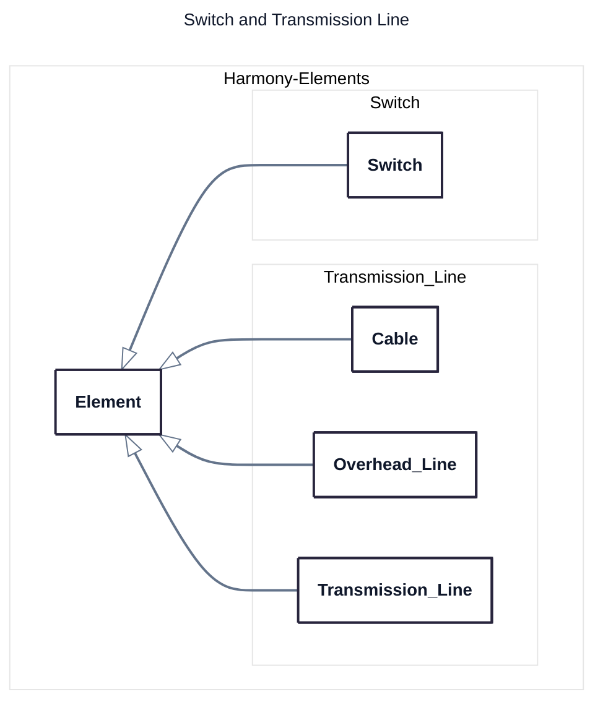
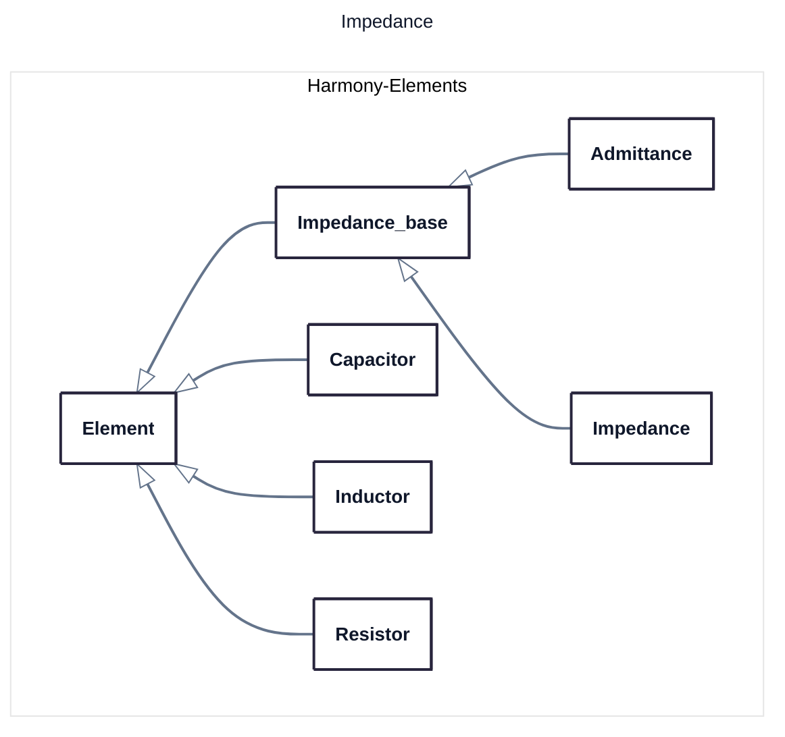
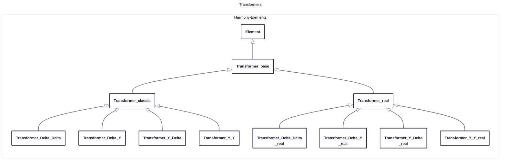
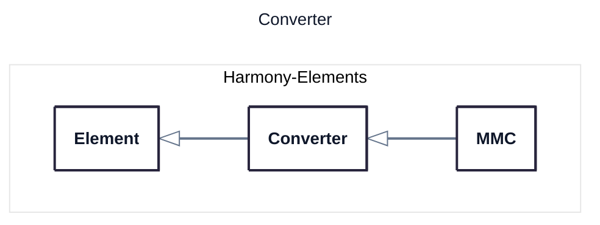
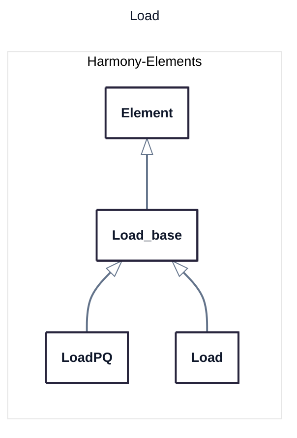
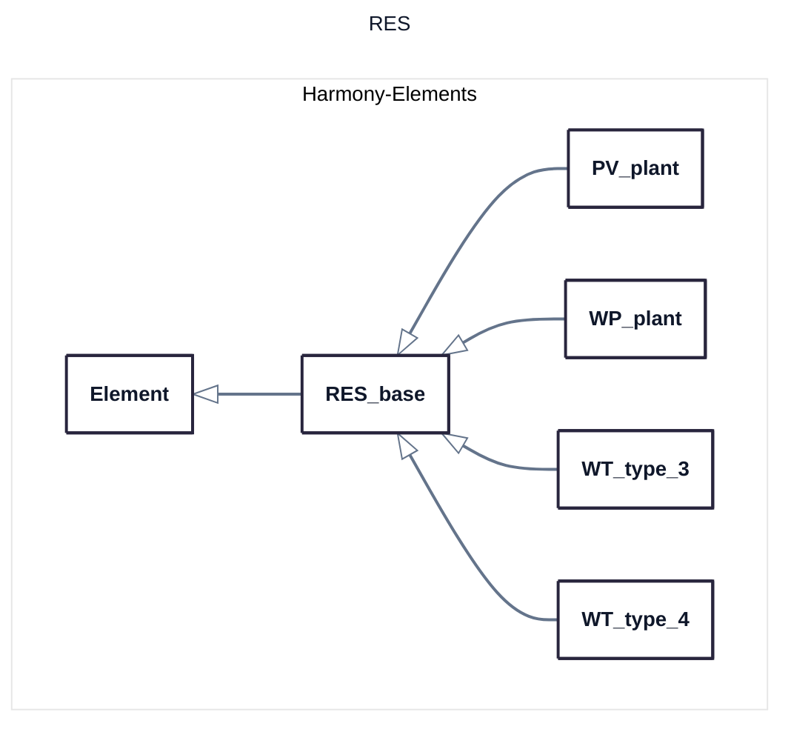
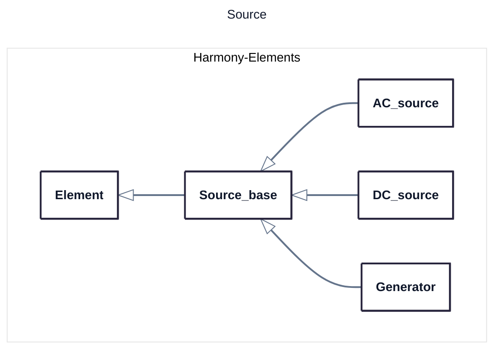

## Elements
 The diagrams below illustrate the class structure and relationships of all Elements in Harmony. All Elements inherit from the `Element` base class.

For readability and ease of navigation, the diagrams are divided into several smaller, interconnected components rather than presenting all classes in a single diagram.

These diagrams are intended to provide an overview of the class hierarchy and the relationships between classes, rather than document their individual implementations or functionality.

For detailed information about each class, including its properties and methods, please refer to the [API documentation](https://cresym.github.io/Harmony-Doc/api/index.html).

### Network and Passive Elements

<!-- ***************************************************************** -->
<!-- SWITCH -->
<!-- TRANSMISSION LINE -->
<!-- ***************************************************************** -->

  
Switch and Transmission Line

  

<!-- ***************************************************************** -->
<!-- IMPEDANCE -->
<!-- ***************************************************************** -->

  
Impedance

  

<!-- ***************************************************************** -->
<!-- TRANSFORMERS -->
<!-- ***************************************************************** -->

  
Transformers

  

## Generators, Loads and Converters

<!-- ***************************************************************** -->
<!-- CONVERTER -->
<!-- ***************************************************************** -->

  
Converter

  

<!-- ***************************************************************** -->
<!-- LOAD -->
<!-- ***************************************************************** -->

  
Load

  

<!-- ***************************************************************** -->
<!-- RES -->
<!-- ***************************************************************** -->

  
RES

  

<!-- ***************************************************************** -->
<!-- SOURCE -->
<!-- ***************************************************************** -->

  
Source

  

